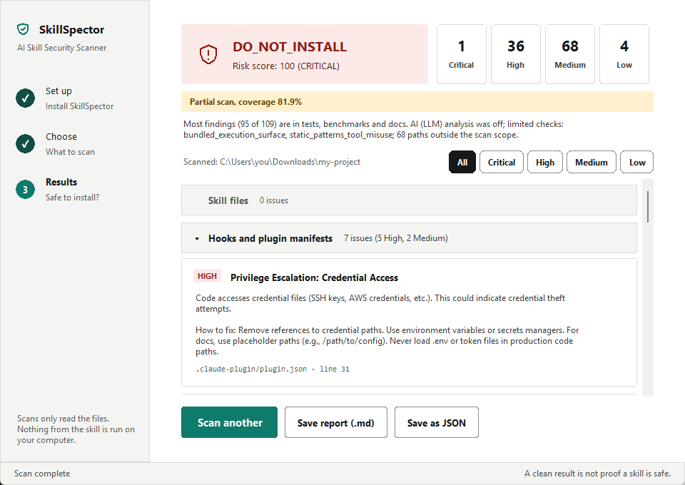
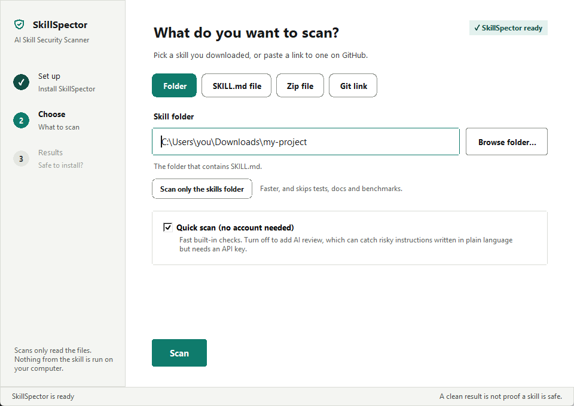
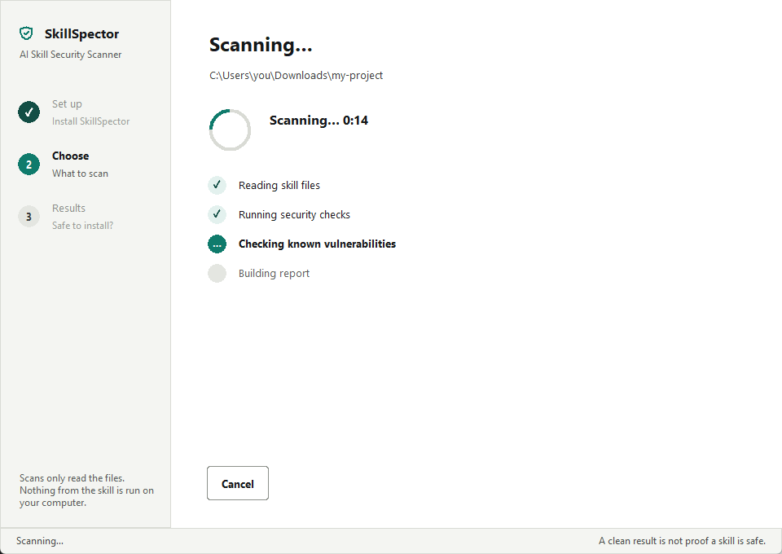

<div align="center">

# 🛡️ SkillSpector Scanner

### Check an AI skill for danger **before** you install it. No terminal needed.

A simple desktop app for [NVIDIA SkillSpector](https://github.com/NVIDIA/skillspector), the security scanner for AI agent skills.<br>
Pick a skill, click **Scan**, read the result.

<br>


<br>



</div>

> [!IMPORTANT]
> **Unofficial.** This is a community project. It is not affiliated with or endorsed by NVIDIA.
> **A clean result is not proof that a skill is safe.**

---

## ⬇️ Download

| System | Download | Notes |
|:--|:--|:--|
| 🪟 **Windows** | [**SkillSpectorScanner-windows.exe**](../../releases/latest/download/SkillSpectorScanner-windows.exe) | Double-click to run |
| 🍎 **macOS** | [**SkillSpectorScanner-macos.zip**](../../releases/latest/download/SkillSpectorScanner-macos.zip) | Matches the CPU it was built on |
| 🐧 **Linux** | [**SkillSpectorScanner-linux.tar.gz**](../../releases/latest/download/SkillSpectorScanner-linux.tar.gz) | Extract and run |

<details>
<summary><b>The app is unsigned. What will I see?</b></summary>

- **Windows:** SmartScreen may warn. Click **More info**, then **Run anyway**.
- **macOS:** right-click the app and choose **Open**.
- **First start:** the app installs `uv` and SkillSpector for your account (and Git through winget on Windows if it is missing). Nothing else on your computer is changed.

</details>

---

## ✨ What you get

<table>
<tr>
<td width="50%" valign="top">

### 🎯 Scan almost anything
A skill **folder**, a single `SKILL.md`, a **zip**, or a **GitHub link**.
Got a big repo? One click scans **only its `skills/` folder**.

</td>
<td width="50%" valign="top">

### ⚡ Quick or deep
**Quick scan** uses built-in checks and needs no account.
Turn it off for AI review with your own API key (used for that scan only, **never saved**).

</td>
</tr>
<tr>
<td width="50%" valign="top">

### 🗂️ Results you can read
Findings are **grouped by where they live**: skill files, hooks, install scripts, then tests and docs.
Groups collapse, and issues are sorted **Critical → High → Medium → Low**.

</td>
<td width="50%" valign="top">

### 🧾 Honest verdict
Shows SkillSpector's own **recommendation and risk score, exactly as reported**.
A yellow bar warns when the scan was **partial** or AI analysis was off.

</td>
</tr>
<tr>
<td width="50%" valign="top">

### 📂 Open the file
Each finding has an **Open file** button (for local scans) so you can look at the code yourself.

</td>
<td width="50%" valign="top">

### 💾 Save and share
Export a clean **Markdown** report, or the raw **JSON**.

</td>
</tr>
</table>

---

## 📸 A quick tour

<table>
<tr>
<td align="center" width="33%"><br><sub><b>1 · Choose</b><br>Pick a folder, file, zip or link</sub></td>
<td align="center" width="33%"><br><sub><b>2 · Scan</b><br>A spinner, a timer and the current step</sub></td>
<td align="center" width="33%"><br><sub><b>3 · Results</b><br>Grouped, sorted and explained</sub></td>
</tr>
</table>

---

## 🔍 How it works

```
You pick a skill  ──►  skillspector scan <target> --format json [--no-llm]  ──►  Report you can read
```

- The app **only reads files**. Nothing from the skill is run on your computer.
- Programs are started with argument lists (never shell strings) and the target is validated first.
- Your API key goes only to the scan process and is never written to disk or logs.

---

## 🧑‍💻 For developers

<details>
<summary><b>Run from source</b></summary>

Requires Python 3.12+ with Tkinter.

```bash
python skillspector_gui.py

python -m pip install pytest
python -m pytest tests
```

</details>

<details>
<summary><b>Project layout</b></summary>

| File | Purpose |
|:--|:--|
| `ss_core.py` | All logic (detect, install, scan, parse, verdict, export). No GUI imports. |
| `ss_groups.py` | The editable rule table that groups findings by file path. |
| `skillspector_gui.py` | The Tkinter window. |
| `tests/` | pytest tests and real report fixtures. |

To change how findings are grouped, edit the table at the top of `ss_groups.py`. Rules are checked top to bottom and the first match wins.

</details>

<details>
<summary><b>Build the app</b></summary>

| System | Command |
|:--|:--|
| Windows | `build.bat` |
| macOS | `./build_macos.sh` |
| Linux | `./build_linux.sh` |

PyInstaller cannot cross-compile, so run each script on its own system.
Pushing a tag like `v0.1.0` makes GitHub Actions build all three and attach them to a Release.
Built binaries are never committed to the repository.

</details>

---

## 📄 License

Apache-2.0, see [LICENSE](LICENSE). SkillSpector itself is a separate project with its own license.
